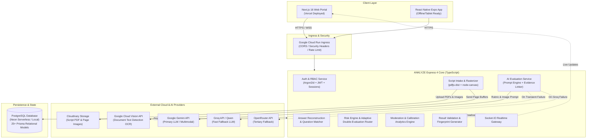
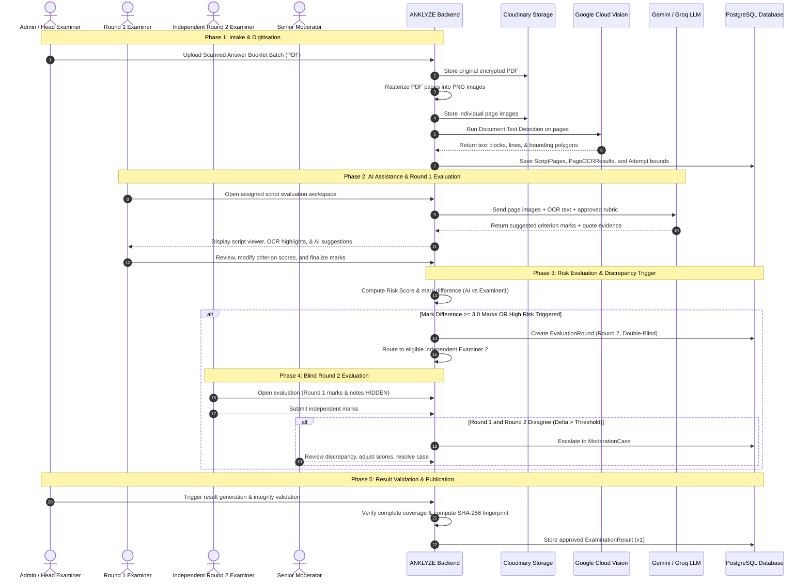

<div align="center">


# ANKLYZE

**“Analyse the marks, not just the paper.”**

*A Next-Generation, AI-Assisted Examination Answer-Sheet Evaluation & Moderation Platform*

[](https://anklyze-flame.vercel.app)
[](https://anklyze-gitconnect-38002070587.asia-south1.run.app)
[](https://anklyze-gitconnect-38002070587.asia-south1.run.app/api/v1/health)
[](https://www.typescriptlang.org/)
[](https://nextjs.org/)
[](https://www.prisma.io/)
[](https://www.postgresql.org/)

</div>

---

## 📖 Table of Contents

- [1. Executive Overview](#1-executive-overview)
- [2. Key Features](#2-key-features)
- [3. Live Deployments and Demo Links](#3-live-deployments-and-demo-links)
- [4. System Architecture & Data Flow](#4-system-architecture--data-flow)
- [5. Technology Stack](#5-technology-stack)
- [6. Repository Structure](#6-repository-structure)
- [7. Prerequisites](#7-prerequisites)
- [8. Installation and Local Setup](#8-installation-and-local-setup)
- [9. Environment Variables](#9-environment-variables)
- [10. API Specification & Endpoints](#10-api-specification--endpoints)
- [11. AI Evaluation & Human Decision Workflow](#11-ai-evaluation--human-decision-workflow)
- [12. Database, Storage, and Security Controls](#12-database-storage-and-security-controls)
- [13. Deployment Architecture](#13-deployment-architecture)
- [14. Troubleshooting & Operational Guide](#14-troubleshooting--operational-guide)
- [15. Project Status, Roadmap & Contributing](#15-project-status-roadmap--contributing)
- [16. License](#16-license)

---

## 1. Executive Overview

**ANKLYZE** is an enterprise-grade, AI-assisted examination answer-sheet evaluation platform engineered to modernise large-scale academic assessment for universities, state examination boards (such as MPOnline and state technical universities), and institutional testing authorities.

### The Problem
Traditional subjective paper evaluation suffers from systemic challenges:
1. **Inter-Examiner Variance & Bias**: Different evaluators score subjective student answers with wide disparity depending on fatigue, strictness, or subjective interpretation.
2. **Operational Latency**: Manual collation, physical transit of paper booklets, and paper mark tabulation consume weeks to months.
3. **Absence of Auditability**: Once a paper is graded, tracing why a student received partial marks against a specific rubric criterion is nearly impossible without costly revaluations.
4. **Administrative Vulnerability**: Erroneous totals, unattempted question miscalculations, and fraudulent mark alterations frequently escape detection.

### The ANKLYZE Solution
ANKLYZE digitises and accelerates this lifecycle while ensuring **humans retain complete authoritative control**:
- **Strict Human-in-the-Loop Governance**: AI never finalises marks autonomously. It acts strictly as an advisory co-evaluator that extracts text, maps answers to question criteria, calculates suggested marks with evidence citations, and highlights ambiguous responses.
- **Evidence-First Scoring**: Every mark awarded is tied to an explicit bounding region on the scanned answer page and verifiable rubric criteria.
- **Adaptive Double Evaluation**: When an examiner's score diverges from the baseline suggestion by $\ge 3.0$ marks, ANKLYZE triggers a mandatory, double-blind independent Round 2 evaluation by an eligible peer examiner.
- **Cryptographic Provenance**: Evaluation decisions, criterion overrides, and finalized score sheets carry SHA-256 fingerprints, complete JSON diffs, and immutable audit logs.

---

## 2. Key Features

### 📄 Answer-Sheet & PDF Intake
- **Batch-Oriented Intake**: Upload multi-page student answer scripts in bulk with batch tracking (`ScriptBatch`), duplicate checksum detection (SHA-256), and status validation.
- **Secure Cloud & Local Storage**: Integrated Cloudinary asset storage with fallback to local mock file handling for offline environments.
- **Supplementary Booklet Linking**: Automatic or manual pairing of primary answer booklets with supplementary booklets (`SupplementaryScriptLink`) via barcode or sequence ordering.
- **Server-Side Rasterization**: High-resolution page rasterization (`pdfjs-dist` + `canvas`) converting input PDF documents into web-optimised PNG images for granular OCR coordinate extraction.

### 🔍 OCR & Spatial Document Processing
- **Google Cloud Vision Engine**: Integration with Cloud Vision Document Text Detection (`DOCUMENT_TEXT_DETECTION`), returning words, paragraphs, blocks, and normalized bounding polygons.
- **Confidence Scoring & Language Detection**: Page-level and block-level OCR confidence tracking with support for bilingual English/Hindi scripts.
- **Reprocessing & Versioning**: Versioned OCR records (`PageOCRResult`) ensuring historic extraction results remain accessible if reprocessing with updated pipelines is needed.

### 📐 Automated Answer Reconstruction & Question Mapping
- **Spatial Attempt Reconstruction**: Reconstructs fragmented and multi-page student answers into unified question attempts (`QuestionAttempt`) linked to specific page regions (`AnswerRegion`).
- **State Handling**: Detects and handles diverse answer conditions including unattempted questions (`BLANK`), cancelled attempts (`CANCELLED`), multi-page continuations (`CONTINUATION`), and duplicates.
- **Examiner Overrides**: Super Admins and Head Examiners can manually remap, re-index, or resolve misidentified student answers directly through the API.

### 🎯 Rubric-Based AI Marking Engine
- **Rubric Extraction & Structuring**: Parses syllabus marking schemes into granular evaluation criteria with maximum scores, partial-credit policies, and alternative-method allowances.
- **Evidence Quote Grounding**: Every suggested score is accompanied by extracted verbatim quotes and bounding box coordinates from the student's script.
- **Confidence Bands**: Scores categorized into `HIGH`, `MEDIUM`, or `LOW` confidence bands, flagging low-confidence assessments for mandatory manual review.

### ✍️ Examiner Review & Immutable Decision Lifecycle
- **Unified Examiner Workspace**: Split-screen interface presenting high-resolution script pages alongside marking rubrics, AI suggestions, and criterion controls.
- **Full Override Capability**: Human examiners can accept AI suggestions, override specific criterion marks, or enter custom feedback with mandatory override justifications.
- **Immutable Decision Trail**: Versioned records (`ExaminerEvaluationDecision`) recording decision types (`ACCEPT_AI_SUGGESTION`, `OVERRIDE_AI`, `SAVE_DRAFT`, `FINALIZE`, `REOPEN`) with complete JSON diffs and audit logs.

### ⚖️ Evaluation Risk Engine & Adaptive Double Evaluation
- **Multi-Factor Risk Scoring**: Real-time evaluation risk engine computing bounded risk scores ($0 - 100$) across 8 distinct factors (OCR quality, AI uncertainty, rubric ambiguity, human-AI disagreement, etc.).
- **Unrounded $\ge 3.0$ Mark Trigger**: An exact mark discrepancy of $\ge 3.0$ points between AI recommendation and Round 1 examiner score triggers an automated independent Round 2 evaluation.
- **Double-Blind Independence**: Round 2 examiners cannot view Round 1 evaluations, scores, or examiner notes until Round 2 completion is signed off.
- **Conflict-Free Examiner Routing**: Automatically locates eligible second evaluators assigned to the same subject while strictly excluding the primary evaluator.

### 🛡️ Moderation & Quality Calibration
- **Moderation Queue**: Dedicated queue for Senior Moderators and Head Examiners to audit high-risk evaluations, double-evaluation disagreements, and examiner escalations.
- **Pedagogical Calibration Sets**: Standardised sample answer sets (`CalibrationSet` and `CalibrationItem`) to assess and calibrate examiner grading standards before official live grading.
- **Evaluator Drift Tracking**: Longitudinal statistical monitoring detecting examiner grading drift (e.g. grading becoming significantly more lenient or severe over time).

### 📊 Validation, Results & Revaluation
- **Pre-Publication Validation**: Rule engine enforcing strict publication criteria (complete question coverage, non-negative totals, resolved moderation cases).
- **Cryptographic Result Fingerprints**: SHA-256 fingerprint generated over all question marks, source decisions, and rubric versions for tamper detection.
- **Formal Revaluation System**: Governed revaluation requests allowing full result review or question-specific re-evaluation with immutable v2 result generation.

---

## 3. Live Deployments and Demo Links

The following live services are verified and operational:

| Service | Environment | URL | Status |
| :--- | :--- | :--- | :--- |
| **Frontend Web App** | Vercel Production | [https://anklyze-flame.vercel.app](https://anklyze-flame.vercel.app) | 🟢 Live |
| **Backend API Service** | Google Cloud Run | [https://anklyze-gitconnect-38002070587.asia-south1.run.app](https://anklyze-gitconnect-38002070587.asia-south1.run.app) | 🟢 Live |
| **Liveness Health Check** | Cloud Run Probe | [https://anklyze-gitconnect-38002070587.asia-south1.run.app/health](https://anklyze-gitconnect-38002070587.asia-south1.run.app/health) | 🟢 HTTP 200 |
| **Database Readiness Check** | API Gateway Probe | [https://anklyze-gitconnect-38002070587.asia-south1.run.app/api/v1/health/ready](https://anklyze-gitconnect-38002070587.asia-south1.run.app/api/v1/health/ready) | 🟢 Connected |
| **OpenAPI Specification** | JSON Spec Endpoint | [https://anklyze-gitconnect-38002070587.asia-south1.run.app/api/v1/docs](https://anklyze-gitconnect-38002070587.asia-south1.run.app/api/v1/docs) | 🟢 Interactive JSON |

> **Note on Frontend Live Data Status**: The public frontend and authentication shell load live against Cloud Run. However, certain interior administrative and examiner dashboard screens currently render static demonstration fixtures while backend API integrations are finalised (see [Project Status](#15-project-status-roadmap--contributing)).

---

## 4. System Architecture & Data Flow

### Architectural Diagram



### End-to-End Evaluation Lifecycle Flow



---

## 5. Technology Stack

### Backend Architecture
- **Runtime**: Node.js (`>= 20.0.0`)
- **Web Framework**: Express.js (`v4.21.2`)
- **Language**: TypeScript (`v5.8.2`) executed via `tsx`
- **Database & ORM**: PostgreSQL via Prisma ORM (`v6.4.1`)
- **Authentication**: Argon2id password hashing (`argon2`), JSON Web Tokens (`jsonwebtoken`), secure cookie parsing (`cookie-parser`)
- **Validation**: Zod (`v3.24.2`) for schema enforcement
- **Document & PDF Processing**: `pdfjs-dist` (`v4.10.38`), `canvas` (`v3.2.0`), `pdf-lib` (`v1.17.1`), `multer` (`v2.4.0`)
- **Realtime Gateway**: Socket.IO (`v4.8.4`)
- **Observability & Logging**: Pino (`v9.6.0`) with `pino-http`

### External AI & Cloud Services
- **Cloud Document Storage**: Cloudinary SDK (`v2.11.0`)
- **OCR Engine**: Google Cloud Vision API (`@google-cloud/vision v6.1.1`)
- **Primary AI Provider**: Google Gemini (`gemini-3.8-flash` multimodal)
- **Fallback AI Providers**: Groq API (`qwen/qwen3.8-27b`), OpenRouter API (`qwen/qwen3.8-27b`)

### Frontend Web Portal
- **Framework**: Next.js (`v16.3.6`, App Router architecture)
- **Library**: React (`v19.2.8`) & React DOM (`v19.2.8`)
- **Styling**: Tailwind CSS (`v4.0.0`) with CSS Modules
- **Animation**: GSAP (`v3.14.2`)
- **Iconography**: Lucide React (`v1.48.0`)

### Mobile Client (Prototyped)
- **Framework**: React Native (`0.76.0`) with Expo (`~52.0.0`)
- **Secure Storage**: `expo-secure-store` (`~14.0.0`)
- **Realtime Client**: `socket.io-client` (`v4.8.4`)

---

## 6. Repository Structure

```text
AnkLyze/
├── Backend/                            # Core API, Evaluation Engine & Persistence
│   ├── prisma/
│   │   ├── schema.prisma               # 25+ relational models (Exams, Rubrics, Scripts, Rounds)
│   │   └── seed.ts                     # Database seeding with standard roles and demo entities
│   ├── src/
│   │   ├── ai/                         # Multi-provider AI engine (Gemini, Groq, OpenRouter)
│   │   │   ├── prompts/                # Versioned evaluation and rubric analysis prompts
│   │   │   └── providers/              # Provider implementations & fallback handlers
│   │   ├── config/                     # Environment configuration and validation (Zod)
│   │   ├── controllers/                # HTTP request handlers
│   │   ├── docs/                       # OpenAPI 3.0 specification (`openapi.ts`)
│   │   ├── middleware/                 # Auth, RBAC guards, rate-limiting, error handlers
│   │   ├── ocr/                        # Google Cloud Vision client & OCR normalizer
│   │   ├── repositories/               # Prisma database access layer
│   │   ├── routes/                     # Express REST routes mounted at /api/v1
│   │   ├── schemas/                    # Request/response validation schemas
│   │   ├── services/                   # Core business logic (Risk, Evaluation, Moderation, Results)
│   │   ├── socket/                     # Socket.IO websocket event gateway
│   │   ├── storage/                    # Cloudinary & local storage providers
│   │   ├── tests/                      # Automated test suite (20+ test runners)
│   │   ├── app.ts                      # Express application assembly & CORS configuration
│   │   └── server.ts                   # HTTP & WebSocket server bootstrapper
│   ├── package.json
│   └── tsconfig.json
│
├── Frontend/                           # Next.js 16 Web Application
│   ├── public/                         # Static assets (logos, icons, videos)
│   │   ├── anklyze-logo.png
│   │   └── anklyze-mark.png
│   ├── src/
│   │   ├── app/                        # App Router routes & layouts
│   │   │   ├── admin/                  # Administrative portals (exams, scripts, results, analytics)
│   │   │   ├── examiner/               # Examiner workspace, queue, calibration, reports
│   │   │   ├── moderation/             # Moderation queues and case detail views
│   │   │   ├── login/                  # Role-based authentication view
│   │   │   └── layout.tsx              # Root application layout
│   │   ├── components/                 # Reusable UI components
│   │   │   ├── evaluation/             # Script viewer, rubric panel, scoring controls
│   │   │   ├── examiner/               # Activity queues, progress indicators, navigation dock
│   │   │   └── marketing/              # Landing page interactive sections & storytelling
│   │   ├── context/                    # React Contexts (AuthContext, RealtimeContext)
│   │   ├── data/                       # Development mock datasets and fixtures
│   │   └── utils/                      # API client (`apiClient.ts`), report exporters
│   ├── package.json
│   └── next.config.ts
│
├── Mobile/                             # Expo React Native Mobile Client
│   ├── src/
│   │   ├── components/                 # Mobile answer viewer & scoring widgets
│   │   ├── screens/                    # Login, Dashboard, Evaluation workspace screens
│   │   └── services/                   # Mobile API client & local secure storage
│   ├── App.tsx                         # Mobile entry point
│   └── package.json
│
└── README.md                           # Comprehensive documentation (this file)
```

---

## 7. Prerequisites

Before installing and running ANKLYZE locally, ensure your environment meets these requirements:

| Tool / Dependency | Required Version | Verification Command |
| :--- | :--- | :--- |
| **Node.js** | `>= 20.0.0` (LTS recommended) | `node -v` |
| **npm** | `>= 9.0.0` | `npm -v` |
| **PostgreSQL** | `>= 15.0` (or Neon Serverless account) | `psql --version` |
| **Git** | `>= 2.30.0` | `git --version` |

### Required External Service Accounts (for full cloud functionality)
1. **Google Cloud Platform**: Project with **Cloud Vision API** enabled (Service Account JSON or API Key).
2. **Google AI Studio**: **Gemini API Key** (`gemini-3.8-flash`).
3. **Groq Console**: **Groq API Key** (`qwen/qwen3.8-27b`) for LLM failover.
4. **Cloudinary**: Cloud name, API key, and API secret for answer-sheet PDF/image hosting.

*(Note: For offline local testing, `STORAGE_PROVIDER=mock`, `OCR_PRIMARY_PROVIDER=mock`, and `AI_PRIMARY_PROVIDER=mock` can be used in development mode; however, production strictly forbids mock providers).*

---

## 8. Installation and Local Setup

### Step 1: Clone the Repository
```bash
git clone https://github.com/Anshult72/AnkLyze.git
cd AnkLyze
```

### Step 2: Configure and Boot the Backend
```bash
# Navigate to Backend
cd Backend

# Install dependencies
npm install

# Copy environment template
cp .env.example .env

# Edit .env with your PostgreSQL credentials and API keys
# (Ensure DATABASE_URL points to a running PostgreSQL instance)

# Generate Prisma Client code
npm run prisma:generate

# Apply database migrations / push schema
npm run prisma:push

# (Optional) Seed standard roles and demo accounts
npm run prisma:seed

# Start the Backend in development watch mode (runs on port 5000 by default)
npm run dev
```
The Backend will start at `http://localhost:5000`. You can verify it by opening `http://localhost:5000/health` or `http://localhost:5000/api/v1/health`.

### Step 3: Configure and Boot the Frontend
Open a new terminal window:
```bash
# Navigate to Frontend
cd Frontend

# Install dependencies
npm install

# Create local environment configuration
# Point NEXT_PUBLIC_API_URL to your local backend
echo "NEXT_PUBLIC_API_URL=http://localhost:5000/api/v1" > .env.local
echo "NEXT_PUBLIC_SOCKET_URL=http://localhost:5000" >> .env.local

# Run Next.js in development mode (runs on port 3000 by default)
npm run dev
```
Open `http://localhost:3000` in your web browser.

### Step 4: Run the Backend Automated Test Suite
To verify backend pipeline integrity, run the automated integration tests:
```bash
cd Backend
npm run test:auth
npm run test:workflow
npm run test:decision
npm run test:risk
```

---

## 9. Environment Variables

### Backend Configuration (`Backend/.env`)

| Variable | Required in Prod | Default (Dev) | Description |
| :--- | :---: | :--- | :--- |
| `NODE_ENV` | Yes | `development` | Runtime environment (`development`, `production`, `test`) |
| `PORT` | No | `5000` | HTTP service port |
| `API_PREFIX` | No | `/api/v1` | URL prefix for REST endpoints |
| `CORS_ORIGIN` | Yes | `http://localhost:3000` | Allowed comma-separated origins for web clients |
| `PUBLIC_FRONTEND_ORIGIN`| No | `https://anklyze-flame.vercel.app` | Secondary production frontend origin |
| `DATABASE_URL` | **Yes** | `postgresql://postgres:...` | PostgreSQL connection string |
| `LOG_LEVEL` | No | `info` | Pino log verbosity (`fatal`, `error`, `warn`, `info`, `debug`) |
| `JWT_ACCESS_SECRET` | **Yes** | *(Dev secret)* | Minimum 32-character secret for signing access JWTs |
| `JWT_REFRESH_SECRET` | **Yes** | *(Dev secret)* | Minimum 32-character secret for signing refresh JWTs |
| `JWT_ACCESS_EXPIRES_IN`| No | `15m` | Lifetime of access tokens |
| `JWT_REFRESH_EXPIRES_IN`| No | `7d` | Lifetime of refresh tokens |
| `COOKIE_SECURE` | Yes | `false` | Set to `true` in production to enforce HTTPS cookies |
| `COOKIE_SAME_SITE` | No | `lax` | SameSite cookie attribute (`lax`, `strict`, `none`) |
| `AI_PRIMARY_PROVIDER` | No | `gemini` | Primary LLM provider (`gemini`, `groq`, `openrouter`, `mock`) |
| `AI_FALLBACK_PROVIDER` | No | `groq` | Failover LLM provider (`groq`, `openrouter`, `gemini`, `none`) |
| `AI_PROVIDER_CHAIN` | No | `gemini,groq,openrouter` | Comma-separated order for AI fallback failover |
| `GEMINI_API_KEY` | **Yes** | `""` | Google AI Studio API key |
| `GEMINI_MODEL` | No | `gemini-3.8-flash` | Gemini model identifier |
| `GROQ_API_KEY` | Conditional | `""` | Groq Console API key for fallback |
| `GROQ_MODEL` | No | `qwen/qwen3.8-27b` | Groq model identifier |
| `STORAGE_PROVIDER` | Yes | `cloudinary` | Storage driver (`cloudinary` or `mock`) |
| `CLOUDINARY_CLOUD_NAME`| Conditional | `""` | Cloudinary cloud account name |
| `CLOUDINARY_API_KEY` | Conditional | `""` | Cloudinary API key |
| `CLOUDINARY_API_SECRET`| Conditional | `""` | Cloudinary API secret |
| `MAX_SCRIPT_FILE_SIZE_BYTES`| No| `26214400` | Maximum upload script size in bytes (25 MB default) |
| `OCR_PRIMARY_PROVIDER` | Yes | `google-vision` | Primary OCR engine (`google-vision` or `mock`) |
| `GOOGLE_VISION_API_KEY`| Conditional | `""` | Google Cloud Vision API key or credentials |

> **Security Rule**: Never commit actual API keys, passwords, or JWT secrets to source control. Production environments on Google Cloud Run configure these as encrypted Cloud Run environment variables or Secret Manager references.

### Frontend Configuration (`Frontend/.env.local`)

| Variable | Required | Example Value | Description |
| :--- | :---: | :--- | :--- |
| `NEXT_PUBLIC_API_URL` | Yes | `https://anklyze-gitconnect-38002070587.asia-south1.run.app/api/v1` | Base REST endpoint for the backend |
| `NEXT_PUBLIC_SOCKET_URL` | No | `https://anklyze-gitconnect-38002070587.asia-south1.run.app` | Base URL for realtime Socket.IO connections |

---

## 10. API Specification & Endpoints

All REST endpoints are prefixed by `/api/v1` unless indicated otherwise. Interactive JSON specification is accessible at `/api/v1/docs`.

### 1. Health & Diagnostics
| Method | Route | Access | Purpose |
| :--- | :--- | :--- | :--- |
| `GET` | `/health` | Public | Liveness probe returning service version and uptime |
| `GET` | `/api/v1/health` | Public | Standard API liveness probe |
| `GET` | `/api/v1/health/ready` | Public | Readiness probe validating PostgreSQL database connectivity |

### 2. Authentication & Identity
| Method | Route | Access | Purpose |
| :--- | :--- | :--- | :--- |
| `POST` | `/api/v1/auth/login` | Public (Rate Limited) | Authenticate user via email/password; returns JWT + sets cookie |
| `POST` | `/api/v1/auth/refresh` | Public | Exchange refresh token for fresh access token |
| `POST` | `/api/v1/auth/logout` | Authenticated | Invalidate active session |
| `GET` | `/api/v1/auth/me` | Authenticated | Retrieve authenticated user profile and permissions |

### 3. Examination & Question Paper Management
| Method | Route | Minimum Role | Purpose |
| :--- | :--- | :--- | :--- |
| `GET` | `/api/v1/exams` | Authenticated | List all examination packages |
| `POST` | `/api/v1/exams` | `HEAD_EXAMINER` | Create a new examination session |
| `GET` | `/api/v1/subjects` | Authenticated | List all active examination subjects |
| `POST` | `/api/v1/question-papers/subjects/:id` | `HEAD_EXAMINER` | Upload question paper PDF for candidate extraction |
| `POST` | `/api/v1/question-papers/:id/process` | `HEAD_EXAMINER` | Extract candidate questions from uploaded PDF |
| `POST` | `/api/v1/question-papers/:id/approve` | `HEAD_EXAMINER` | Approve and publish extracted questions to question bank |

### 4. Answer Script Intake & OCR Processing
| Method | Route | Minimum Role | Purpose |
| :--- | :--- | :--- | :--- |
| `POST` | `/api/v1/script-batches` | `HEAD_EXAMINER` | Create an answer script intake batch |
| `POST` | `/api/v1/script-batches/:id/scripts` | `HEAD_EXAMINER` | Upload student answer script PDFs (multipart) |
| `GET` | `/api/v1/scripts/:id/processing` | `EXAMINER` | Inspect rasterization and OCR processing status |
| `GET` | `/api/v1/scripts/:id/pages` | `EXAMINER` | List rasterized script pages and OCR word coordinates |
| `POST` | `/api/v1/scripts/:id/process` | `HEAD_EXAMINER` | Trigger rasterization and Google Vision OCR pipeline |

### 5. Answer Reconstruction & AI Evaluation
| Method | Route | Minimum Role | Purpose |
| :--- | :--- | :--- | :--- |
| `POST` | `/api/v1/scripts/:id/reconstruct` | `HEAD_EXAMINER` | Reconstruct question attempts across script pages |
| `GET` | `/api/v1/scripts/:id/attempts` | `EXAMINER` | Retrieve reconstructed student question attempts |
| `POST` | `/api/v1/question-attempts/:id/evaluate` | `EXAMINER` | Generate AI evaluation suggestion with evidence citations |
| `GET` | `/api/v1/question-attempts/:id/evaluation` | `EXAMINER` | Get latest AI evaluation suggestion and confidence |
| `PATCH` | `/api/v1/evaluations/:id/decision` | `EXAMINER` | Save examiner mark decision (Accept, Override, Draft) |
| `POST` | `/api/v1/evaluations/:id/finalize` | `EXAMINER` | Finalize evaluation decision with immutable JSON diff |
| `POST` | `/api/v1/evaluations/:id/reopen` | `EXAMINER` | Reopen a finalized decision with mandatory rationale |

### 6. Risk Engine & Adaptive Double Evaluation
| Method | Route | Minimum Role | Purpose |
| :--- | :--- | :--- | :--- |
| `POST` | `/api/v1/question-attempts/:id/risk-assess`| `EXAMINER` | Compute multi-factor risk score for an attempt |
| `GET` | `/api/v1/question-attempts/:id/risk` | `EXAMINER` | Retrieve latest risk breakdown and score contributions |
| `POST` | `/api/v1/question-attempts/:id/second-evaluation`| `HEAD_EXAMINER`| Request independent Round 2 evaluation |
| `GET` | `/api/v1/question-attempts/:id/eligible-second-examiners` | `HEAD_EXAMINER` | List conflict-free eligible Round 2 examiners |
| `POST` | `/api/v1/evaluation-rounds/:id/complete`| `EXAMINER` | Submit and complete independent Round 2 evaluation |
| `GET` | `/api/v1/question-attempts/:id/double-evaluation-result`| `HEAD_EXAMINER`| Compare Round 1 vs Round 2 discrepancies |

### 7. Moderation, Calibration & Quality Analytics
| Method | Route | Minimum Role | Purpose |
| :--- | :--- | :--- | :--- |
| `GET` | `/api/v1/moderation/cases` | `MODERATOR` | List active moderation cases and escalation triggers |
| `POST` | `/api/v1/moderation/cases/:id/resolve`| `MODERATOR` | Submit authoritative moderation decision |
| `POST` | `/api/v1/calibration/sets` | `HEAD_EXAMINER` | Create standardized calibration set for examiner training |
| `GET` | `/api/v1/analytics/drift` | `HEAD_EXAMINER` | Monitor examiner longitudinal scoring drift |

### 8. Result Validation, Publication & Revaluation
| Method | Route | Minimum Role | Purpose |
| :--- | :--- | :--- | :--- |
| `POST` | `/api/v1/results/generate` | `HEAD_EXAMINER` | Generate or recompute student result total |
| `POST` | `/api/v1/results/:id/validate` | `HEAD_EXAMINER` | Run pre-publication rule engine validation |
| `POST` | `/api/v1/results/:id/approve` | `HEAD_EXAMINER` | Approve and publish finalized result with SHA-256 hash |
| `POST` | `/api/v1/results/:id/revaluation`| `EXAMINER` | Initiate formal revaluation request on published result |

---

## 11. AI Evaluation & Human Decision Workflow

ANKLYZE strictly enforces an **advisory-first, human-governed AI evaluation model**:

```text
[ Scanned PDF ] 
       │
       ▼
[ Page Rasterization (PNG) ] ──▶ [ Cloud Vision OCR ]
       │                                 │
       └──────────────┬──────────────────┘
                      ▼
        [ Multimodal LLM Prompt ]
     (Page Image + OCR Text + Rubric)
                      │
                      ▼
         [ AI Suggested Marks ]
       + Evidence Quotes from Script
       + Confidence Band (High/Med/Low)
                      │
                      ▼
         ┌─────────────────────────┐
         │ Human Examiner Review   │
         │ - Accepts suggestion OR │
         │ - Overrides criteria    │
         └────────────┬────────────┘
                      │
                      ▼
      [ Unrounded Mark Difference Check ]
     |AI Suggested Marks - Examiner Marks|
                      │
        ┌─────────────┴─────────────┐
        ▼                           ▼
    < 3.0 Marks                >= 3.0 Marks
(Within Tolerance)       (Divergence Detected)
        │                           │
        │                           ▼
        │             [ Mandatory Double-Blind ]
        │             [    Round 2 Evaluation  ]
        │             (Round 1 marks hidden)
        │                           │
        │                           ▼
        │             [ Double Evaluation Check ]
        │             |Round 1 - Round 2|
        │                ┌──────────┴──────────┐
        │                ▼                     ▼
        │             Agreed               Disagreed
        │                │                     │
        │                │                     ▼
        │                │             [ Escalated to    ]
        │                │             [ Senior Moderator]
        │                │                     │
        └───────────────┬┴─────────────────────┘
                        ▼
          [ Final Immutable Decision ]
         + Cryptographic Audit Trail
```

### Provider Resilience & Failover Policy
To safeguard against rate limits and transient cloud outages, the evaluation service uses a **tiered provider chain**:
1. **Primary**: Google Gemini (`gemini-3.8-flash`) — executes multimodal analysis using high-resolution page buffers and structured rubric schemas.
2. **Secondary Failover**: Groq (`qwen/qwen3.8-27b`) — automatically triggered if Gemini returns a transient HTTP 429, 503, or network timeout.
3. **Tertiary Failover**: OpenRouter (`qwen/qwen3.8-27b`) — standby failover for catastrophic provider unavailability.
4. **Strict Schema Normalization**: Raw LLM output is validated against a strict Zod schema (`evaluationResponseSchema`). If the model outputs malformed JSON or references non-existent pages, the response is discarded and re-prompted.

---

## 12. Database, Storage, and Security Controls

### Persistence Layer (PostgreSQL & Prisma)
The database schema encompasses **25+ relational entities**:
- **Identity & Access**: `roles`, `users`, `auth_sessions`, `auth_audit_records`
- **Curriculum & Examination**: `exams`, `subjects`, `questions`, `question_papers`, `question_paper_items`, `marking_schemes`, `marking_criteria`, `examiner_assignments`
- **AI Rubric Governance**: `rubric_analyses`, `rubric_analysis_questions`, `rubric_analysis_criteria`, `rubric_analysis_issues`
- **Intake & Document Storage**: `script_batches`, `answer_scripts`, `script_pages`, `page_ocr_results`, `supplementary_script_links`
- **Reconstruction & Attempts**: `script_reconstructions`, `question_attempts`, `question_attempt_pages`, `answer_regions`
- **Evaluation & Decisions**: `evaluations`, `evaluation_criterion_results`, `evaluation_evidence`, `evaluation_issues`, `examiner_evaluation_decisions`, `examiner_criterion_decisions`
- **Risk & Double Evaluation**: `risk_assessments`, `risk_factors`, `evaluation_rounds`, `double_evaluation_results`
- **Moderation & Calibration**: `moderation_cases`, `moderation_decisions`, `calibration_sets`, `calibration_items`, `calibration_sessions`, `calibration_submissions`, `evaluator_drift_observations`
- **Results & Revaluation**: `examination_results`, `result_question_marks`, `result_validations`, `result_validation_issues`, `revaluation_requests`

### Storage Approach
- Answer-sheet PDFs and generated page PNGs are stored securely via Cloudinary (`StorageProviderType.CLOUDINARY`).
- Direct public URLs are not exposed to untrusted clients without authorization.
- SHA-256 hashes are recorded upon initial upload to prevent duplicate script processing.

### Security & Hardening Controls
- **Password Security**: Passwords hashed with **Argon2id** (`memoryCost: 65536`, `timeCost: 3`, `parallelism: 1`).
- **Token Security**: Dual-token pattern using short-lived Access Tokens (15 min) and long-lived Refresh Tokens (7 days) with database-backed revocation (`auth_sessions`).
- **CORS Protection**: Dynamic CORS validation restricted to permitted frontend origins (`CORS_ORIGIN` and `PUBLIC_FRONTEND_ORIGIN`). Preflight `OPTIONS` requests return clean 204 responses.
- **Security Headers**: Standard security headers (HSTS, X-Content-Type-Options: nosniff, Frame Options: DENY, Referrer Policy).
- **Rate Limiting**: Tiered IP-based rate limiting protecting sensitive endpoints (`/auth/login`, `/auth/refresh`, and `/evaluate`).
- **Role-Based Access Control (RBAC)**: Fine-grained middleware checking user roles (`SUPER_ADMIN`, `HEAD_EXAMINER`, `EXAMINER`, `MODERATOR`) on every mutating API route.
- **Blind Review Security**: Round 2 independent examiners are prevented by database query filtering and route guards from inspecting Round 1 scores or annotations while their evaluation round is incomplete.

---

## 13. Deployment Architecture

### Google Cloud Run (Backend)
- Packaged as a containerized Node.js service listening on `$PORT` (`8080` default in Cloud Run).
- Connects to managed PostgreSQL (e.g. Neon Serverless Postgres) via pooled SSL connections (`?sslmode=require`).
- Automatically scales instances based on incoming request volume and PDF processing loads.
- Build command:
  ```bash
  npm run build    # executes: prisma generate && tsc
  npm start        # executes: node dist/server.js
  ```

### Vercel (Frontend)
- Next.js App Router deployed directly to Vercel's global edge network.
- Environment variables configured in Vercel dashboard:
  - `NEXT_PUBLIC_API_URL`: Points to the Cloud Run API URL.
  - `NEXT_PUBLIC_SOCKET_URL`: Points to the Cloud Run origin for WebSocket upgrades.
- Production build command:
  ```bash
  next build
  ```

---

## 14. Troubleshooting & Operational Guide

| Symptom / Error | Probable Cause | Verified Resolution |
| :--- | :--- | :--- |
| `CORS_ORIGIN_FORBIDDEN` on API calls | Frontend origin does not match `CORS_ORIGIN` | Add frontend domain (e.g. `https://anklyze-flame.vercel.app`) to `CORS_ORIGIN` or `PUBLIC_FRONTEND_ORIGIN` in backend `.env`. |
| `Mock providers are forbidden in production` | `NODE_ENV=production` set with mock drivers | Configure real cloud credentials for `CLOUDINARY_*`, `GOOGLE_VISION_*`, and `GEMINI_API_KEY`, or set `NODE_ENV=development` for local testing. |
| `DATABASE_UNAVAILABLE` on `/health/ready` | Database connection string invalid or unreachable | Verify `DATABASE_URL` in `.env`. Ensure your IP is allowed in Neon/cloud firewall, and verify SSL mode (`?sslmode=require`). |
| PDF rasterization fails with `canvas` error | Missing native system dependencies for node-canvas | On Ubuntu/Debian: `sudo apt-get install build-essential libcairo2-dev libpango1.0-dev libjpeg-dev libgif-dev librsvg2-dev`. On Windows: Ensure Visual Studio C++ Build Tools are installed. |
| AI evaluation returns `AIProviderError` | Gemini API key quota exhausted or rate limit hit | Ensure a valid fallback key is set (`GROQ_API_KEY`), or check Google AI Studio project quotas. |
| 403 Forbidden when Examiner opens Round 2 | Examiner attempted to view Round 1 during blind review | Expected security behavior. Round 2 examiners cannot access Round 1 marks until they submit their independent evaluation. |

---

## 15. Project Status, Roadmap & Contributing

### Verified Current Implementation Status
- **Backend Architecture**: Production-grade foundation complete. Comprehensive schemas, 17+ route modules, multi-provider AI engine, Google Vision OCR, risk calculation engine, unrounded 3.0-mark Round 2 trigger, and 20+ automated test suites are implemented and validated locally.
- **Frontend Portal**: Production Next.js 16 app deployed on Vercel with responsive macOS-inspired navigation, authenticated login shell, and interactive UI views.
- **Mobile Prototype**: Functional Expo React Native client with local secure storage and scoring widgets.

### Ongoing Work & Roadmap
1. **Frontend Mock-to-Live Transition**: Replace remaining mock data imports in examiner/admin dashboard views with authenticated live backend endpoints.
2. **Question Paper Ingestion UI**: Enhance frontend admin workbench to support direct PDF upload and interactive candidate review.
3. **End-to-End Live Document Trials**: Execute full real-data evaluation runs with matched subject question papers and scanned student booklets.
4. **Enhanced Mobile Offline Sync**: Enable offline answer sheet evaluation caching on Android/iOS tablets with background synchronisation.

### Contributing
Contributions, issue reports, and feature proposals are welcome:
1. Fork the repository.
2. Create your feature branch (`git checkout -b feature/amazing-feature`).
3. Commit your changes (`git commit -m 'feat: add amazing feature'`).
4. Push to the branch (`git push origin feature/amazing-feature`).
5. Open a Pull Request.

---

## 16. License

This repository and its codebase are currently **UNLICENSED** (All Rights Reserved) as specified in `package.json`. Unauthorized copying, modification, distribution, or commercial deployment without explicit written permission from the ANKLYZE project maintainers is strictly prohibited.

---

<div align="center">
  <sub>Built with precision for modern examination authorities. <strong>ANKLYZE</strong> — Analyse the marks, not just the paper.</sub>
</div>
